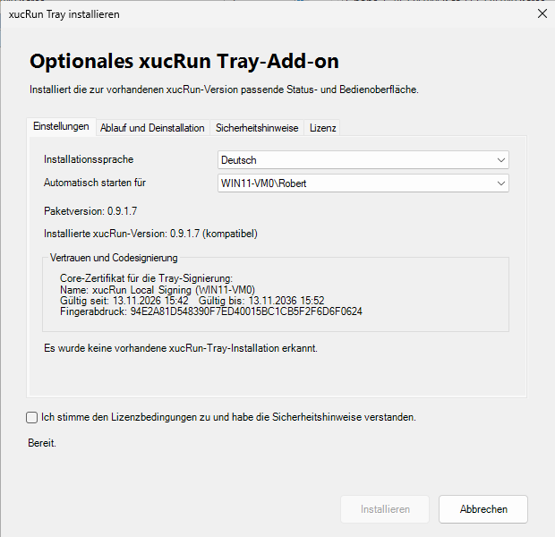
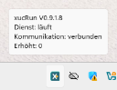
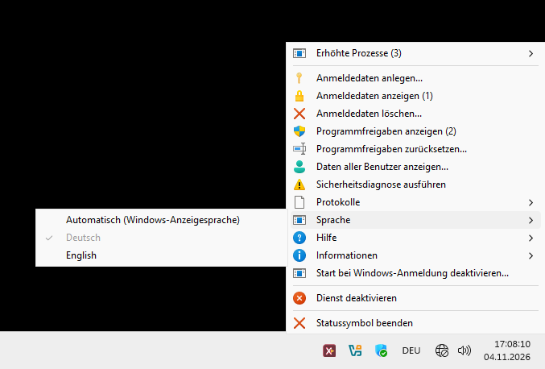
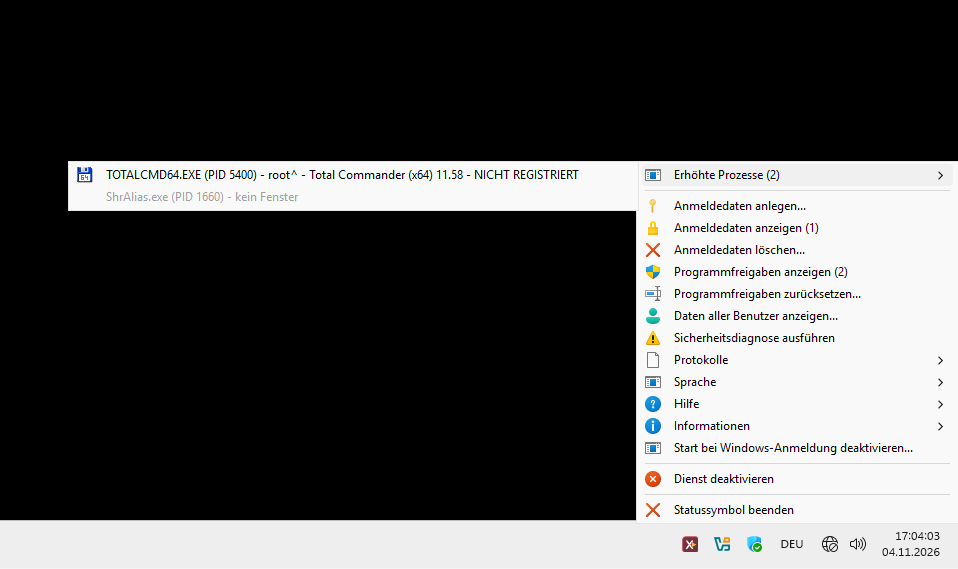
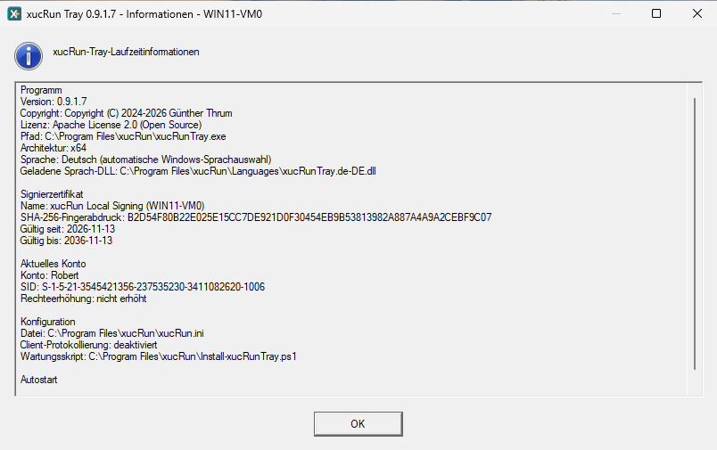

<!--
Purpose: Beschreibt xucRun Tray, seine Voraussetzungen, Installation, Bedienung und Entwicklung.
Approach: Führt Anwender von der Einordnung über sichere Nutzung und Entfernung bis zum Quellbuild.
-->
# xucRun Tray

**Sprache:** [English](README.md) | Deutsch

**Dokumentation:** [Installation](docs/de/INSTALLATION.md) |
[Build-Anleitung](docs/de/BUILDING.md) | [Änderungsprotokoll](CHANGELOG.de.md) |
[Manuelle Entfernung](docs/de/MANUAL_REMOVAL.md) | [xucRun](https://github.com/HT64/xucRun)

**Projektstatus:** xucRun Tray wird aktiv gepflegt.<br>
**Lizenz:** [Apache License 2.0](LICENSE)<br>
**Download:** [Aktuelles Installationspaket und Prüfsummen](https://github.com/HT64/xucRun-Tray/releases)

## Motivation und Zweck

xucRun Tray ist eine optionale Status- und Bedienoberfläche für
[xucRun](https://github.com/HT64/xucRun). Sein Symbol erscheint im Benachrichtigungsbereich der
Windows-Taskleiste neben der Uhr. Von dort aus lassen sich wichtige Betriebsinformationen anzeigen
und häufig verwendete xucRun-Verwaltungsfunktionen direkt aufrufen, ohne Befehle manuell eingeben
zu müssen.

Die Tray-Anwendung ersetzt xucRun nicht und ist nicht eigenständig nutzbar. Sie zeigt Informationen
aus xucRun an und erleichtert den Zugriff auf dessen vorhandene Verwaltungsfunktionen.
Programmstarts, gespeicherte Anmeldedaten, Freigaben, Kontowahl und Sicherheitsentscheidungen
bleiben weiterhin Aufgaben von xucRun.

Das Tray kann dauerhaft oder nur bei Bedarf verwendet werden. Es ist insbesondere bei der
Inbetriebnahme, bei der Kontrolle des Betriebszustands und bei späteren Änderungen an
Anmeldedaten, Freigaben oder Konfiguration hilfreich. xucRun und sein Brokerdienst bleiben
vollständig nutzbar, während das Tray nicht läuft.

Der zu xucRun gehörende Brokerdienst wird bei Bedarf automatisch gestartet und läuft anschließend
im Hintergrund. Die Tray-Anwendung zeigt seinen Zustand an und ermöglicht seine Bedienung über die
vorhandenen xucRun-Funktionen, übernimmt aber selbst keine Brokerfunktion.

Die Tray-Anwendung:

- zeigt Status von Brokerdienst und Kommunikation;
- zeigt den aktuellen Benutzerkontext und eine mögliche Erhöhung des Tray-Prozesses;
- listet verfolgte erhöhte Prozesse und deren Fenster;
- öffnet xucRun-Dialoge zur Verwaltung von Anmeldedaten und Programmfreigaben;
- startet Sicherheitsdiagnose und Informationsansichten von xucRun;
- ermöglicht den Zugriff auf konfigurierte Client-Logdateien und gefilterte xucRun-Brokerereignisse;
- wechselt die xucRun-Programmsprache;
- startet, aktiviert oder deaktiviert den Brokerdienst über die vorhandenen xucRun-Schnittstellen.

Sensible Aktionen werden weiterhin von xucRun unter Verwendung der Windows-Zugriffskontrollen und
erforderlichenfalls der Benutzerkontensteuerung ausgeführt. Die Installation von xucRun Tray erzeugt
keine zusätzlichen Anmeldedaten, Freigaben oder Berechtigungen für den Brokerdienst.

## Voraussetzungen und Einsatzbereich

xucRun Tray unterstützt Windows 10 und Windows 11 auf x64-Systemen. Es benötigt:

- ein installiertes, unterstütztes xucRun;
- derzeit exakt dieselbe vierteilige Produktversion wie xucRun;
- eine Signatur mit demselben gültigen lokalen xucRun-Signaturzertifikat wie das installierte
  xucRun;
- ein vorhandenes lokales Windows-Benutzerprofil für den Autostart von xucRun Tray.

xucRun Tray richtet sich wie xucRun an erfahrene Privatanwender und Entwickler auf selbst
verwalteten Rechnern sowie in persönlichen Entwicklungs- und Testsystemen. Es ist keine Lösung für
unbeaufsichtigte Rechteerhöhung, zentrale Rechteverwaltung oder Systeme mit erhöhtem Schutzbedarf.

> **Schutzgrenzen:** xucRun Tray zeigt Statusinformationen an und ruft vorhandene
> Verwaltungsfunktionen von xucRun auf. Es erweitert weder die Berechtigungen von xucRun noch
> ersetzt es dessen Sicherheitsmechanismen. Aus den angezeigten Informationen lässt sich keine
> Garantie für die Sicherheit des Systems, der Anmeldedaten oder gestarteter Programme ableiten.
> Für den vollständigen Einsatzbereich, die Schutzmechanismen, Einsatzgrenzen und verbleibenden
> Risiken gilt das
> [Sicherheitsmodell von xucRun](https://github.com/HT64/xucRun/blob/main/docs/de/SECURITY_MODEL.md).

## Installation

1. Zuerst die exakt passende xucRun-Version installieren.
2. Tray-Installer und `SHA256SUMS.txt` aus demselben
   [xucRun-Tray-Release](https://github.com/HT64/xucRun-Tray/releases) herunterladen.
3. Optional die SHA-256-Prüfsumme vergleichen und den Installer bei einer Abweichung nicht
   ausführen.
4. `xucRun-Tray-<Version>-x64.exe` starten, die Windows-UAC-Anforderung bestätigen und den lokalen
   Benutzer für den Tray-Autostart auswählen.



Die [Installationsanleitung](docs/de/INSTALLATION.md) beschreibt Paketinhalt und -prüfung, lokale
Signierung, grafische Installation, Reparatur, Aktualisierung und Deinstallation. Ist die normale
Deinstallation nicht verfügbar, gilt die Anleitung zur
[manuellen Entfernung](docs/de/MANUAL_REMOVAL.md).

## Schnellstart

Ist der gewählte Benutzer aktuell angemeldet, startet der Installer xucRun Tray sofort über die
Benutzeraufgabe ohne erhöhte Rechte. Andernfalls startet xucRun Tray bei der nächsten
Windows-Anmeldung dieses Benutzers. Für einen manuellen Start öffne eine Eingabeaufforderung und
führe aus:

```cmd
"C:\Program Files\xucRun\xucRunTray.exe"
```

Das Beispiel nimmt den Windows-Standardpfad an. Bei einer abweichenden Installation muss der
tatsächliche absolute Pfad zu `xucRunTray.exe` verwendet werden; der Aufruf sollte den Pfad nicht
über eine Umgebungsvariable oder `PATH` bestimmen.

In derselben Benutzersitzung läuft nur eine Tray-Instanz. Bewege den Mauszeiger über das Symbol im
Benachrichtigungsbereich der Windows-Taskleiste neben der Uhr, um Benutzer-, Brokerdienst-,
Kommunikations- und Erhöhungsstatus zu sehen. Ein Rechtsklick öffnet das Verwaltungsmenü.

Die Farbe des Symbols fasst den aktuellen Zustand zusammen:

- Die normale Symbolfarbe zeigt an, dass der Brokerdienst läuft, die Kommunikation funktioniert
  und kein sichtbares Hauptfenster eines von xucRun verfolgten erhöhten Prozesses geöffnet ist.
- Ein graues Symbol zeigt an, dass der Brokerdienst nicht läuft, deaktiviert ist oder noch nicht
  verfügbar ist.
- Ein rotes Symbol weist auf eine gestörte Brokerkommunikation oder auf mindestens ein sichtbares
  Hauptfenster eines verfolgten erhöhten Prozesses hin.
- Bei funktionierender Brokerkommunikation pulsiert das rote Symbol einmal pro Sekunde, wenn
  mindestens ein sichtbares Hauptfenster zu einem Prozess mit wirksamer
  Identität `NT SERVICE\TrustedInstaller` gehört. Fenster gewöhnlicher erhöhter Prozesse und
  LocalSystem-Prozesse lassen das Symbol durchgehend rot erscheinen.

Ein rotes Symbol ist daher nicht immer ein Fehlerhinweis.

Bei funktionierender Brokerkommunikation dient das rote Symbol als direkt sichtbarer Hinweis
darauf, dass noch mindestens ein sichtbares Hauptfenster eines verfolgten erhöhten Prozesses
geöffnet ist. So bleiben auch erhöhte Anwendungen erkennbar, deren Fenster von anderen Fenstern
verdeckt sind. Das ist besonders hilfreich, wenn aus einem erhöhten Prozess weitere Anwendungen
gestartet wurden, da diese ebenfalls im erhöhten Sicherheitskontext ausgeführt werden können.
Die pulsierende TrustedInstaller-Anzeige folgt validierten Kindprozessen, solange sie die wirksame
TrustedInstaller-Identität behalten und ein sichtbares Hauptfenster besitzen.

Beim Verweilen des Mauszeigers über dem Symbol zeigt ein Tooltip den aktuellen Status von
xucRun Tray.



Läuft die Tray-Anwendung selbst mit erhöhten Rechten, erscheint zusätzlich das Windows-Schild auf
dem Symbol.

## Statusanzeige und Menü

Abhängig von xucRun-Konfiguration und Berechtigungen bietet das Menü:

- verfolgte erhöhte Prozesse und deren Fenster;
- Anlegen, Anzeigen und Löschen gespeicherter Anmeldedaten;
- Anzeigen und Zurücksetzen von Programmfreigaben;
- eine administrative Ansicht über Benutzer hinweg nach der erforderlichen Erhöhung;
- Sicherheitsdiagnose sowie Hilfe- und Informations-Untermenüs für xucRun und xucRun Tray;
- Anzeigen oder Löschen der aktuellen Client-Logdatei sowie Anzeigen der xucRun-Brokerereignisse;
- Löschen aller Client-Logdateien im konfigurierten Logverzeichnis nach Bestätigung;
- automatische, deutsche und englische Sprachwahl;
- Aktivieren oder Deaktivieren des automatischen Starts für das aktuelle Benutzerkonto;
- Starten, Aktivieren oder Deaktivieren des Brokerdienstes;
- Beenden der aktuellen Tray-Instanz.



Unter **Erhöhte Prozesse** führt das Menü die von xucRun verfolgten Prozesse und ihre sichtbaren
Hauptfenster auf. Diese Liste ist keine systemweite Übersicht aller erhöhten oder
SYSTEM-Prozesse: Sie enthält die über xucRun gestarteten Prozesse einschließlich ihrer erkannten
Folgeprozesse sowie erhöhte Administratorprozesse der eigenen Windows-Sitzung. Solange mindestens
ein Prozess mit der Identität LocalSystem oder TrustedInstaller verfolgt wird, beginnt jeder
Eintrag mit der vom Broker validierten wirksamen Identität: `[ADM]` und dem Windows-Kontonamen
für einen erhöhten Administrator, `[SYS] SYSTEM` für LocalSystem oder `[TI] TrustedInstaller` für
LocalSystem mit wirksamer TrustedInstaller-Dienst-SID. Ohne einen solchen Prozess bleiben die
Einträge kompakt; nur Prozessen eines anderen Kontos als dem des angemeldeten Benutzers wird
dessen Kontoname vorangestellt. Ein Klick auf einen Fenstereintrag stellt ein minimiertes Fenster
wieder her und versucht, es in den Vordergrund zu holen. Verhindert Windows den Wechsel in den
Vordergrund, blinkt stattdessen die zugehörige Schaltfläche in der Taskleiste. Prozesse ohne
geeignetes sichtbares Fenster erscheinen als ausgegraute Einträge mit dem Zusatz `kein Fenster`
und können vom Menü aus nicht hervorgeholt werden.



Nicht verfügbare Aktionen sind deaktiviert. Änderungen an Anmeldedaten, Freigaben oder dem
Dienstzustand erfordern weiterhin die von xucRun und Windows vorgesehenen Berechtigungen und
Bestätigungen.

Die Sprachwahl ändert die computerweite xucRun-Konfiguration. **Automatisch** folgt der
Windows-Anzeigesprache des jeweiligen Benutzers und verwendet bei einer deutschen Anzeigesprache
Deutsch, andernfalls Englisch. Nach erfolgreicher Änderung starten alle beim Brokerdienst
registrierten Tray-Anwendungen neu, sodass auch die Symbole in anderen Benutzersitzungen sofort den
konfigurierten Sprachmodus verwenden.

## Benutzerkonto und Autostart

Der Installer wählt bewusst ein vorhandenes lokales Benutzerprofil aus und erstellt für dieses
Konto die Anmeldeaufgabe `\xucRun\BrokerStatus-<SID>` ohne erhöhte Rechte. xucRun Tray läuft
anschließend in der interaktiven Sitzung dieses Benutzers und nicht dauerhaft als Administrator. Der Tooltip des
Symbols nennt das Konto und zeigt an, ob der Trayprozess erhöht ausgeführt wird, wenn in derselben
Sitzung eine weitere Trayinstanz vorhanden ist oder das Tray unter einem anderen Konto als der
interaktiv angemeldete Benutzer läuft. Er lässt diese Identität nur weg, wenn sowohl die einzige
Instanz als auch das übereinstimmende Sitzungskonto bestätigt sind.

Vorausgewählt wird der interaktiv angemeldete Benutzer der Windows-Sitzung, aus der der Installer
gestartet wurde. Das gilt auch dann, wenn für die UAC-Abfrage ein anderes Administratorkonto
verwendet wird. Ist dieser Benutzer nicht auswählbar, verwendet der Installer ersatzweise das
erhöhte Prozesskonto und danach den ersten verfügbaren Eintrag. Die Auswahl bleibt immer änderbar.

Starten Sie den Installer für jeden zusätzlichen geeigneten lokalen Benutzer erneut und wählen Sie
jeweils dieses Benutzerkonto aus. Bereits eingerichtete Benutzeraufgaben bleiben dabei erhalten.
Ist der neu ausgewählte Benutzer angemeldet, startet xucRun Tray für diesen Benutzer sofort;
andernfalls startet es bei seiner nächsten Windows-Anmeldung. Bei der Deinstallation werden die
Aufgaben aller eingerichteten Benutzer gemeinsam entfernt.

Der Menüeintrag zeigt abhängig vom aktuellen Zustand **Start bei Windows-Anmeldung aktivieren...**
oder **Start bei Windows-Anmeldung deaktivieren...**. Das Ändern dieser Einstellung erfordert eine
UAC-Bestätigung. Wird das Tray nach der Einrichtung nicht dauerhaft benötigt, kann zunächst
**Start bei Windows-Anmeldung deaktivieren...** und anschließend für die aktuelle Instanz
**Beenden** gewählt werden. Allein durch das Deaktivieren läuft die aktuelle Tray-Instanz bis zum
manuellen Beenden oder Abmelden weiter. Nach dem Beenden verschwindet ihr Symbol aus dem
Benachrichtigungsbereich und der Tray-Prozess wird beendet; xucRun bleibt vollständig nutzbar. Das
Tray kann später wie unter [Schnellstart](#schnellstart) beschrieben manuell gestartet und der
Start bei Windows-Anmeldung bei Bedarf über das Menü wieder aktiviert werden. Bei nur
gelegentlicher Verwendung kann der Autostart deaktiviert bleiben. Eine fehlende oder abweichende
Aufgabe wird beim Aktivieren vollständig mit der vorgesehenen nicht erhöhten Konfiguration neu
erstellt.

Dieselben benutzerbezogenen Aktionen stehen für Skripte und Problembehebung als Aufrufparameter zur
Verfügung:

```cmd
"C:\Program Files\xucRun\xucRunTray.exe" /enable-autostart
"C:\Program Files\xucRun\xucRunTray.exe" /disable-autostart
"C:\Program Files\xucRun\xucRunTray.exe" /autostart-status
"C:\Program Files\xucRun\xucRunTray.exe" /info
"C:\Program Files\xucRun\xucRunTray.exe" /help
```

`/autostart-status` zeigt den ermittelten Zustand an und beendet sich mit Exitcode `0`, wenn der
Autostart vollständig gültig und aktiviert ist, mit `1`, wenn er fehlt, deaktiviert oder ungültig
konfiguriert ist, und mit `2`, wenn der Zustand nicht zuverlässig ermittelt werden konnte. `/info`
zeigt ausschließlich Informationen über Tray-Programm und -Installation. Die gemeinsamen
Programm-, Signatur-, Konto- und Konfigurationsbereiche stammen aus derselben Implementierung wie
bei `xucRun /info` und nennen Version, Copyright, Lizenz unter der Apache License 2.0,
Pfad, Architektur, wirksame Sprache und
geladene Sprach-DLL, Signierzertifikat, Konto, SID, Rechteerhöhung, Konfigurationsdatei und
Client-Protokollierung. Der gemeinsame Konfigurationsabschnitt nennt außerdem das öffentliche
Tray-Wartungsskript. Tray-spezifisch folgt die Windows-Anmeldeaufgabe ohne erhöhte Rechte zusammen
mit ihrem Zustand. Angezeigt wird nur der Pfad der für diese Ausgabe geladenen
Sprach-DLL; die andere installierte Sprach-DLL wird nicht aufgeführt. `/help` erläutert die
öffentlichen Tray-Aufrufe und ihre Exitcodes. Das Hilfe-Untermenü öffnet wahlweise
`xucRun /help` oder die Tray-eigene Hilfe direkt in der laufenden Tray-Instanz. Das
Informations-Untermenü öffnet wahlweise `xucRun /info` oder die Tray-eigene Informationsansicht
direkt in der laufenden Tray-Instanz. Andere Aufrufparameter werden mit einer Fehlermeldung und
`ERROR_INVALID_PARAMETER` abgewiesen.


## Sicherheitshinweise

Installieren Sie zuerst die passende xucRun-Version und danach xucRun Tray ausschließlich mit dem
Tray-Installer. Der Installer prüft die vorhandene xucRun-Installation, die Produktversion und das
Signaturzertifikat. Kopieren Sie die Programmdateien nicht manuell.

xucRun Tray:

- benötigt keine Internetverbindung;
- speichert kein eigenes Kennwort und keine eigene Datenbank für Anmeldedaten;
- lockert die Sicherheits- und Signaturprüfungen von xucRun nicht;
- bietet keinen Alternativweg an xucRun-Freigaben oder der Benutzerkontensteuerung vorbei;
- verändert bei seiner Deinstallation keine xucRun-Dateien.

Für xucRun Tray gelten die im
[xucRun-Sicherheitsmodell](https://github.com/HT64/xucRun/blob/main/docs/de/SECURITY_MODEL.md)
dokumentierten Betriebsgrenzen und verbleibenden Risiken.

## Sprache und Protokolle

xucRun Tray verwendet die für xucRun konfigurierte Sprache und kann über sein Menü zwischen
Automatisch, Deutsch und Englisch wechseln. Eine fehlende, ungültige oder nicht passend signierte
Sprachressource führt
zum Startabbruch, statt ersatzweise eine ungeprüfte Sprachdatei zu verwenden.

Die Client-Logdatei-Menüeinträge beziehen sich auf das von xucRun konfigurierte
Client-Logverzeichnis. Ist die Client-Dateiprotokollierung deaktiviert oder existiert keine
Logdatei, bleiben die entsprechenden Aktionen deaktiviert. **Alle Logdateien löschen...** zeigt in
Klammern die Anzahl der aktuell ermittelten löschbaren Client-Logdateien an. Das Tray liest die
Logging-Konfiguration bei jedem Öffnen seines Kontextmenüs neu ein und ermittelt dabei die
vorhandenen Logdateien. Ist das konfigurierte Verzeichnis, insbesondere ein Netzwerkpfad, nicht
erreichbar, können Windows-Dateisystemzeitüberschreitungen deshalb auch das Öffnen des
Tray-Kontextmenüs verzögern. Änderungen am konfigurierten Verzeichnis und neu angelegte Logdateien
stehen ohne Neustart des Trays zur Verfügung. Vor dem Öffnen prüft es außerdem die konfigurierte
Sprache. Erkennt es eine gültige externe Änderung, startet es sich selbst neu und verwendet danach
die neue Sprache. Einen ungültigen Wert oder eine ungültige Sprachressource meldet es, bleibt aber
in der bisherigen Sprache aktiv. Technische Brokerwarnungen und -fehler werden
unabhängig von der gewählten UI-Sprache immer auf Englisch in das
Windows-Anwendungsereignislog unter der Quelle `xucRunBroker` geschrieben, wie von xucRun
dokumentiert. Der stets verfügbare Menüeintrag **xucRun-Brokerereignisse anzeigen** öffnet diesen
Windows-Kanal ohne UAC-Abfrage und filtert die gestartete Ansicht vorübergehend auf genau diese
Quelle. Andere Ansichten und spätere Aufrufe der Ereignisanzeige bleiben ungefiltert. Die Aktion
speichert keine benutzerdefinierte Ansicht und löscht oder konfiguriert keine Ereignisse.

## Fehlerdiagnose

- **Das Symbol von xucRun Tray erscheint nicht:** Prüfen Sie, ob sich der gewählte Benutzer nach
  der Installation angemeldet hat und ob `\xucRun\BrokerStatus-<SID>` in der Aufgabenplanung
  vorhanden ist.
- **Der Installer lehnt xucRun ab:** Prüfen Sie die exakten vierteiligen Versionen, die
  unterstützte xucRun-Installation und den registrierten xucRun-Installationspfad.
- **Die Signierung schlägt fehl:** Bei einem mit rechnerlokalem Zertifikat signierten xucRun muss
  dessen bereits vorhandener nicht exportierbarer privater Schlüssel auf diesem Rechner verfügbar
  bleiben. Der Installer lehnt Pakete ab, deren Tray-Dateien nur teilweise oder nicht einheitlich
  signiert sind.
- **Die Kommunikation wird als gestört angezeigt:** Prüfen Sie den Brokerdienst und führen Sie
  über das Tray-Menü oder mit `xucRun /audit` die xucRun-Sicherheitsdiagnose aus. Die Diagnose
  prüft die installierten Tray-Dateien und Signaturen, die Deinstallationsregistrierung und die
  benutzerbezogenen Autostartaufgaben.
- **Menüaktionen sind nicht verfügbar:** Der Brokerdienst kann beendet, die Kommunikation kann
  gestört oder das aktuelle Konto nicht ausreichend berechtigt sein.
- **xucRun Tray startet nach manuellem Kopieren nicht:** Verwenden Sie den Installer. Version,
  geschützter Installationspfad, Signaturzertifikat, Sprachressourcen und Anmeldeaufgabe gehören
  zur unterstützten Installation.

## Projekt unterstützen

Die Entwicklung von xucRun Tray kann freiwillig über
[Patreon](https://www.patreon.com/xucRun) unterstützt werden.

## Schwachstellen melden

Ungepatchte oder vermutete Schwachstellen dürfen nicht öffentlich gemeldet werden. Der vertrauliche
Meldeweg über GitHub Private Vulnerability Reporting für `HT64/xucRun-Tray` ist in
[SECURITY.de.md](SECURITY.de.md) beschrieben.

## Selbst bauen und paketieren

Die [Buildanleitung](docs/de/BUILDING.md) beschreibt Voraussetzungen, Core-Abhängigkeit,
Toolchain-Bericht, Paketierung und Prüfung.

## Mitwirken

Externe Pull Requests werden derzeit nicht angenommen. Einzelheiten stehen in
[CONTRIBUTING.de.md](CONTRIBUTING.de.md).

## Lizenz

xucRun Tray ist Open Source und wird unter der [Apache License 2.0](LICENSE) angeboten.
[NOTICE](NOTICE) enthält Urheberhinweise.
