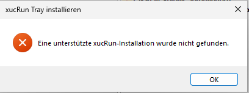
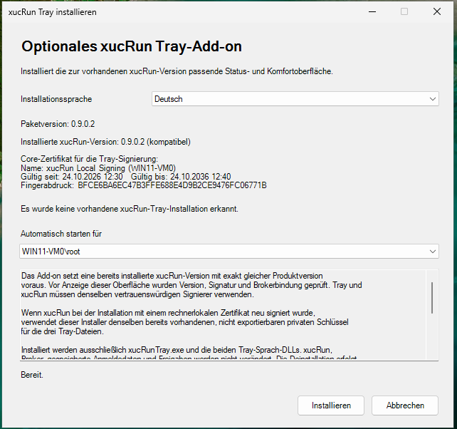
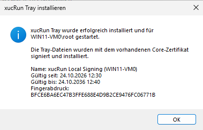
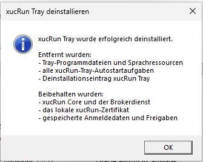
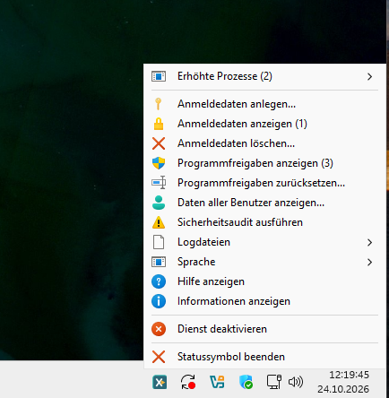
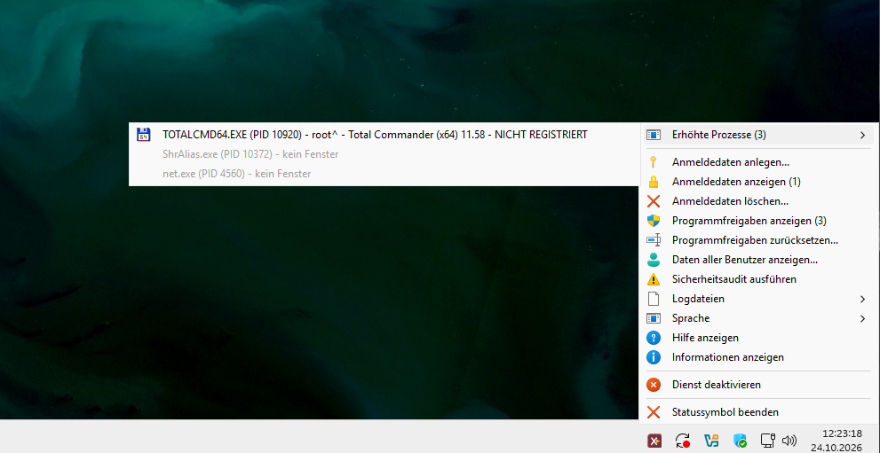

<!--
Purpose: Beschreibt xucRun Tray, seine Voraussetzungen, Installation, Bedienung und Entwicklung.
Approach: Führt Anwender von der Einordnung über sichere Nutzung und Entfernung bis zum Quellbuild.
-->
# xucRun Tray

**Sprache:** [English](README.md) | Deutsch

**Dokumentation:** [Dateiregister](FILE_REGISTER.md) | [Änderungsprotokoll](CHANGELOG.de.md) |
[Manuelle Entfernung](docs/de/MANUAL_REMOVAL.md) | [xucRun](https://github.com/HT64/xucRun)

> **Status:** xucRun Tray befindet sich in Entwicklung. Die Dokumentation beschreibt das
> vorgesehene Verhalten. Der aktuelle Stand kann Fehler enthalten, davon abweichen und sich ändern.
> Das aktuelle Installationspaket und seine Prüfsummen stehen unter
> [Releases](https://github.com/HT64/xucRun-Tray/releases) bereit.

## Motivation und Zweck

xucRun Tray ist eine optionale Status- und Bedienoberfläche für
[xucRun](https://github.com/HT64/xucRun). Sein Symbol erscheint im Benachrichtigungsbereich der
Windows-Taskleiste neben der Uhr. Von dort aus lassen sich wichtige Betriebsinformationen anzeigen
und häufig verwendete xucRun-Verwaltungsfunktionen direkt aufrufen, ohne Befehle manuell eingeben
zu müssen.

Die Tray-Anwendung ersetzt xucRun nicht und ist nicht eigenständig nutzbar. Sie zeigt Informationen
aus xucRun an und erleichtert den Zugriff auf dessen vorhandene Verwaltungsfunktionen.
Programmstarts, gespeicherte Anmeldedaten, Freigaben, Kontowahl und Sicherheitsentscheidungen
bleiben weiterhin Aufgaben von xucRun.

## Verhältnis zu xucRun

Der zu xucRun gehörende Brokerdienst wird bei Bedarf automatisch gestartet und läuft anschließend
im Hintergrund. Die Tray-Anwendung zeigt seinen Zustand an und ermöglicht seine Bedienung über die
vorhandenen xucRun-Funktionen, übernimmt aber selbst keine Brokerfunktion.

Die Tray-Anwendung:

- zeigt Status von Brokerdienst und Kommunikation;
- zeigt den aktuellen Benutzerkontext und eine mögliche Erhöhung des Tray-Prozesses;
- listet verfolgte erhöhte Prozesse und deren Fenster;
- öffnet xucRun-Dialoge zur Verwaltung von Anmeldedaten und Programmfreigaben;
- startet Sicherheitsdiagnose und Informationsansichten von xucRun;
- ermöglicht den Zugriff auf konfigurierte Client-Logdateien und gefilterte xucRun-Brokerereignisse;
- wechselt die xucRun-Programmsprache;
- startet, aktiviert oder deaktiviert den Brokerdienst über die vorhandenen xucRun-Schnittstellen.

Sensible Aktionen werden weiterhin von xucRun unter Verwendung der Windows-Zugriffskontrollen und
erforderlichenfalls der Benutzerkontensteuerung ausgeführt. Die Installation von xucRun Tray erzeugt
keine zusätzlichen Anmeldedaten, Freigaben oder Berechtigungen für den Brokerdienst.

## Voraussetzungen und Einsatzbereich

xucRun Tray unterstützt Windows 10 und Windows 11 auf x64-Systemen. Es benötigt:

- ein installiertes, unterstütztes xucRun;
- derzeit exakt dieselbe vierteilige Produktversion wie xucRun;
- eine Signatur mit demselben gültigen lokalen xucRun-Signaturzertifikat wie das installierte
  xucRun;
- ein vorhandenes lokales Windows-Benutzerprofil für den Autostart von xucRun Tray.

xucRun Tray richtet sich wie xucRun an erfahrene Privatanwender und Entwickler auf selbst
verwalteten Rechnern sowie in persönlichen Entwicklungs- und Testsystemen. Es ist nicht für
unbeaufsichtigte oder zentrale Rechteverwaltung, Produktionsumgebungen oder Systeme mit erhöhtem
Schutzbedarf vorgesehen.

> **Wichtiger Sicherheitshinweis:** xucRun Tray zeigt Statusinformationen an und ruft vorhandene
> Verwaltungsfunktionen von xucRun auf. Es erweitert oder ersetzt die Sicherheitsmechanismen von
> xucRun nicht. Aus den angezeigten Informationen lässt sich keine Garantie für die Sicherheit des
> Systems, der Anmeldedaten oder gestarteter Programme ableiten. Für Voraussetzungen,
> Schutzmechanismen, Einsatzgrenzen und verbleibende Risiken beachte die Sicherheitshinweise im
> [README von xucRun](https://github.com/HT64/xucRun#voraussetzungen-und-einsatzbereich).
> Soweit gesetzlich zulässig, sind für xucRun Tray der Gewährleistungsausschluss und die
> Haftungsbegrenzung der [Apache License 2.0](LICENSE) maßgeblich.

## Installation in Kürze

Das öffentliche Tray-Releasepaket enthält:

```text
xucRun-Tray-<Version>-x64.exe
SHA256SUMS.json
LICENSE
NOTICE
```

Das Release enthält bewusst kein separates Binär-ZIP mit `xucRunTray.exe` und den Sprach-DLLs.
Die von GitHub automatisch angebotenen ZIP- und TAR.GZ-Archive enthalten den Quelltext, nicht ein
installierbares Binärpaket. Der veröffentlichte Tray-Installer ist der unterstützte
Installationsweg; ein manuelles Kopieren einzelner Tray-Dateien stellt weder die erforderliche
gemeinsame Signiereridentität her noch richtet es die Anmeldeaufgabe ein.

Lade alle Dateien aus demselben offiziellen
[xucRun-Tray-GitHub-Release](https://github.com/HT64/xucRun-Tray/releases) herunter. Der
bereitgestellte Installer besitzt derzeit keine Signatur eines öffentlich vertrauenswürdigen
Herausgebers; Windows kann deshalb beim Start einen unbekannten Herausgeber melden. Vergleiche vor
dem Start seine SHA-256-Prüfsumme mit `SHA256SUMS.json` und prüfe eine vorhandene
Authenticode-Signatur.

### Grafische Installation

Vor dem Öffnen der Installationsoberfläche prüft der Installer, ob eine passende xucRun-
Installation vorhanden ist. Er prüft die erforderlichen installierten xucRun-Dateien, deren
Signaturen, Installationspfade, Version und Kompatibilität. Eine ordnungsgemäße manuelle
Installation wird nicht allein wegen eines fehlenden Windows-Deinstallationseintrags abgelehnt.
Bei fehlender, abweichender oder nicht überprüfbarer xucRun-Installation bricht der Installer mit
einer Fehlermeldung ab.



Nach erfolgreicher Prüfung zeigt die Oberfläche die installierte xucRun-Version an. Bei einer
vorhandenen Tray-Installation zeigt sie außerdem deren registrierte Version und den Zeitpunkt der
Installation beziehungsweise letzten Aktualisierung an. Zusätzlich nennt sie das zum Signieren
der Tray-Dateien verwendete lokale xucRun-Signaturzertifikat mit Name, Gültigkeitszeitraum und
Fingerabdruck. Die Erfolgsbestätigung wiederholt diese Zertifikatsinformationen.

Der Installer verwendet zunächst die Windows-Anzeigesprache. Über **Installationssprache** lässt
sich die gesamte Installationsoberfläche unmittelbar zwischen Deutsch und Englisch umschalten.
Diese Auswahl betrifft nur die Installer-Oberfläche und ändert nicht die computerweite
xucRun-Programmsprache.



Starte `xucRun-Tray-<Version>-x64.exe`. Die Benutzerkontensteuerung fordert Administratorrechte an.
Der Installer:

1. prüft eingebettetes Paket und Produktversion;
2. prüft die erforderlichen installierten xucRun-Dateien, deren Signaturen, Installationspfade,
   Version und Kompatibilität;
3. prüft, ob xucRun Tray und xucRun mit demselben gültigen lokalen xucRun-Signaturzertifikat
   signiert sind;
4. fragt, für welchen vorhandenen lokalen Windows-Benutzer xucRun Tray automatisch starten soll;
5. installiert `xucRunTray.exe` und beide Sprach-DLLs unter `%ProgramFiles%\xucRun`;
6. erstellt die Anmeldeaufgabe des gewählten Benutzers;
7. registriert unter **Installierte Apps** einen eigenen Eintrag **xucRun Tray**.



xucRun verwendet ein rechnerlokales Signierzertifikat. Der Tray-Installer nutzt dieses bereits vom
Core eingerichtete Zertifikat, um die eingebetteten Tray-Dateien lokal zu signieren. Dadurch können
Windows und xucRun prüfen, dass xucRun und xucRun Tray zur selben Installation gehören und nicht
durch abweichend signierte Dateien ersetzt wurden. xucRun Tray erzeugt kein eigenes Zertifikat und
fügt keine weiteren Vertrauenseinträge hinzu. Zweck und Speicherorte des Zertifikats beschreibt
der Abschnitt
[Lokales Signaturzertifikat](https://github.com/HT64/xucRun#lokales-signaturzertifikat) im
xucRun-README.

Der Tray-Installer installiert oder verändert keine xucRun-Komponenten und keine gespeicherten
Anmeldedaten oder Freigaben.

### Aktualisieren und deinstallieren

xucRun und xucRun Tray benötigen derzeit exakt dieselbe vierteilige Produktversion. Bei einer
erneuten Installation derselben xucRun-Version kann xucRun Tray installiert bleiben, wenn Version
und Signaturzertifikat weiterhin exakt passen. Vor einem Versionswechsel oder der Deinstallation
von xucRun muss **xucRun Tray** über seinen eigenen Eintrag unter **Installierte Apps** entfernt
werden. Nach dem xucRun-Update wird die öffentliche Version von xucRun Tray mit derselben
Versionsnummer installiert.

Zur Reparatur oder erneuten Installation derselben passenden Version wird der Tray-Installer erneut
gestartet und der gewünschte lokale Benutzer ausgewählt. Er prüft die vorhandene Installation und
ersetzt ausschließlich Tray-Dateien. Dafür beendet er die laufenden Tray-Anwendungen kurzzeitig.
Nach erfolgreicher Installation startet er diese Anwendungen sowie xucRun Tray für den neu
ausgewählten angemeldeten Benutzer wieder.

Die Tray-Deinstallation entfernt Tray-Dateien, Anmeldeaufgaben und den Deinstallationseintrag von
xucRun Tray. xucRun einschließlich Brokerdienst, lokales Signaturzertifikat, gespeicherte
Anmeldedaten, Freigaben und Konfiguration bleibt unverändert. Eine sichtbare Erfolgsbestätigung
führt die entfernten und unveränderten Bestandteile getrennt auf.



Beim Start über **Installierte Apps** bleibt das PowerShell-Fenster verborgen. Ein Fehler erscheint
stattdessen in einem sichtbaren Dialog. Das technische Diagnoseprotokoll wird unter
`%ProgramData%\xucRun\InstallerLogs` gespeichert; der Dialog zeigt den vollständigen konkreten
Dateipfad in einem kopierbaren Feld und kann den Protokollordner direkt öffnen. Das Protokoll
enthält Fehler-, Skript- und Systeminformationen, aber keine gespeicherten Kennwörter. Maßgeblich
ist der im Dialog angezeigte Pfad.

## Schnellstart

Ist der gewählte Benutzer aktuell angemeldet, startet der Installer xucRun Tray sofort über die
Benutzeraufgabe ohne erhöhte Rechte. Andernfalls startet xucRun Tray bei der nächsten
Windows-Anmeldung dieses Benutzers. Für einen manuellen Start öffne eine Eingabeaufforderung und
führe aus:

```cmd
"%ProgramFiles%\xucRun\xucRunTray.exe"
```

In derselben Benutzersitzung läuft nur eine Tray-Instanz. Bewege den Mauszeiger über das Symbol im
Benachrichtigungsbereich der Windows-Taskleiste neben der Uhr, um Benutzer-, Brokerdienst-,
Kommunikations- und Erhöhungsstatus zu sehen. Ein Rechtsklick öffnet das Verwaltungsmenü.

Die Farbe des Symbols fasst den aktuellen Zustand zusammen:

- Die normale Symbolfarbe zeigt an, dass der Brokerdienst läuft, die Kommunikation funktioniert
  und kein sichtbares Hauptfenster eines von xucRun verfolgten erhöhten Prozesses geöffnet ist.
- Ein graues Symbol zeigt an, dass der Brokerdienst nicht läuft, deaktiviert ist oder noch nicht
  verfügbar ist.
- Ein rotes Symbol weist auf eine gestörte Brokerkommunikation oder auf mindestens ein sichtbares
  Hauptfenster eines verfolgten erhöhten Prozesses hin.

Ein rotes Symbol ist daher nicht immer ein Fehlerhinweis.

Läuft die Tray-Anwendung selbst mit erhöhten Rechten, erscheint zusätzlich das Windows-Schild auf
dem Symbol. Die genaue Ursache eines Zustands zeigt der Text an, der beim Verweilen des Mauszeigers
über dem Symbol erscheint.

## Statusanzeige und Menü

Abhängig von xucRun-Konfiguration und Berechtigungen bietet das Menü:

- verfolgte erhöhte Prozesse und deren Fenster;
- Anlegen, Anzeigen und Löschen gespeicherter Anmeldedaten;
- Anzeigen und Zurücksetzen von Programmfreigaben;
- eine administrative Ansicht über Benutzer hinweg nach der erforderlichen Erhöhung;
- Sicherheitsdiagnose sowie Hilfe- und Informations-Untermenüs für xucRun und xucRun Tray;
- Anzeigen oder Löschen der aktuellen Client-Logdatei sowie Anzeigen der xucRun-Brokerereignisse;
- Löschen aller Client-Logdateien im konfigurierten Logverzeichnis nach Bestätigung;
- automatische, deutsche und englische Sprachwahl;
- Aktivieren oder Deaktivieren des automatischen Starts für das aktuelle Benutzerkonto;
- Starten, Aktivieren oder Deaktivieren des Brokerdienstes;
- Beenden der aktuellen Tray-Instanz.



Unter **Erhöhte Prozesse** führt das Menü die von xucRun verfolgten Prozesse und ihre sichtbaren
Hauptfenster auf. Ein Klick auf einen Fenstereintrag stellt ein minimiertes Fenster wieder her und
versucht, es in den Vordergrund zu holen. Verhindert Windows den Wechsel in den Vordergrund, blinkt
stattdessen die zugehörige Schaltfläche in der Taskleiste. Prozesse ohne geeignetes sichtbares
Fenster werden angezeigt, können von dort aber nicht hervorgeholt werden.



Nicht verfügbare Aktionen sind deaktiviert. Änderungen an Anmeldedaten, Freigaben oder dem
Dienstzustand erfordern weiterhin die von xucRun und Windows vorgesehenen Berechtigungen und
Bestätigungen.

Die Sprachwahl ändert die computerweite xucRun-Konfiguration. **Automatisch** folgt der
Windows-Anzeigesprache des jeweiligen Benutzers und verwendet bei einer deutschen Anzeigesprache
Deutsch, andernfalls Englisch. Nach erfolgreicher Änderung starten alle beim Brokerdienst
registrierten Tray-Anwendungen neu, sodass auch die Symbole in anderen Benutzersitzungen sofort den
konfigurierten Sprachmodus verwenden.

## Benutzerkonto und Autostart

Der Installer wählt bewusst ein vorhandenes lokales Benutzerprofil aus und erstellt für dieses
Konto die Anmeldeaufgabe `\xucRun\BrokerStatus-<SID>` ohne erhöhte Rechte. xucRun Tray läuft
anschließend in der interaktiven Sitzung dieses Benutzers und nicht dauerhaft als Administrator. Der Tooltip des
Symbols nennt das Konto und zeigt an, ob der Trayprozess erhöht ausgeführt wird, wenn in derselben
Sitzung eine weitere Trayinstanz vorhanden ist oder das Tray unter einem anderen Konto als der
interaktiv angemeldete Benutzer läuft. Er lässt diese Identität nur weg, wenn sowohl die einzige
Instanz als auch das übereinstimmende Sitzungskonto bestätigt sind.

Vorausgewählt wird der interaktiv angemeldete Benutzer der Windows-Sitzung, aus der der Installer
gestartet wurde. Das gilt auch dann, wenn für die UAC-Abfrage ein anderes Administratorkonto
verwendet wird. Ist dieser Benutzer nicht auswählbar, verwendet der Installer ersatzweise das
erhöhte Prozesskonto und danach den ersten verfügbaren Eintrag. Die Auswahl bleibt immer änderbar.

Starte den Installer für jeden zusätzlichen geeigneten lokalen Benutzer erneut und wähle jeweils
dieses Benutzerkonto aus. Bereits eingerichtete Benutzeraufgaben bleiben dabei erhalten. Ist der
neu ausgewählte Benutzer angemeldet, startet xucRun Tray für diesen Benutzer sofort; andernfalls
startet es bei seiner nächsten Windows-Anmeldung. Bei der Deinstallation werden die Aufgaben aller
eingerichteten Benutzer gemeinsam entfernt.

Der Menüeintrag zeigt abhängig vom aktuellen Zustand **Start bei Windows-Anmeldung aktivieren...**
oder **Start bei Windows-Anmeldung deaktivieren...**. Das Ändern dieser Einstellung erfordert eine
UAC-Bestätigung. Beim Deaktivieren läuft die aktuelle Tray-Instanz bis zum manuellen Beenden oder
Abmelden weiter. Eine fehlende oder abweichende Aufgabe wird beim Aktivieren vollständig mit der
vorgesehenen nicht erhöhten Konfiguration neu erstellt.

Dieselben benutzerbezogenen Aktionen stehen für Skripte und Problembehebung als Aufrufparameter zur
Verfügung:

```cmd
"%ProgramFiles%\xucRun\xucRunTray.exe" /enable-autostart
"%ProgramFiles%\xucRun\xucRunTray.exe" /disable-autostart
"%ProgramFiles%\xucRun\xucRunTray.exe" /autostart-status
"%ProgramFiles%\xucRun\xucRunTray.exe" /info
"%ProgramFiles%\xucRun\xucRunTray.exe" /help
```

`/autostart-status` zeigt den ermittelten Zustand an und beendet sich mit Exitcode `0`, wenn der
Autostart vollständig gültig und aktiviert ist, mit `1`, wenn er fehlt, deaktiviert oder ungültig
konfiguriert ist, und mit `2`, wenn der Zustand nicht zuverlässig ermittelt werden konnte. `/info`
zeigt ausschließlich Informationen über Tray-Programm und -Installation. Die gemeinsamen
Programm-, Signatur-, Konto- und Konfigurationsbereiche stammen aus derselben Implementierung wie
bei `xucRun.exe /info` und nennen Version, Copyright, Pfad, Architektur, wirksame Sprache und
geladene Sprach-DLL, Signierzertifikat, Konto, SID, Rechteerhöhung, Konfigurationsdatei und
Client-Protokollierung. Der gemeinsame Konfigurationsabschnitt nennt außerdem das öffentliche
Tray-Wartungsskript. Tray-spezifisch folgt die Windows-Anmeldeaufgabe ohne erhöhte Rechte zusammen
mit ihrem Zustand. Angezeigt wird nur der Pfad der für diese Ausgabe geladenen
Sprach-DLL; die andere installierte Sprach-DLL wird nicht aufgeführt. `/help` erläutert die
öffentlichen Tray-Aufrufe und ihre Exitcodes. Das Hilfe-Untermenü öffnet wahlweise
`xucRun.exe /help` oder die Tray-eigene Hilfe direkt in der laufenden Tray-Instanz. Das
Informations-Untermenü öffnet wahlweise `xucRun.exe /info` oder die Tray-eigene Informationsansicht
direkt in der laufenden Tray-Instanz. Andere Aufrufparameter werden mit einer Fehlermeldung und
`ERROR_INVALID_PARAMETER` abgewiesen. Der interne Integrationstestparameter
`/broker-policy-test` ist nicht für die normale Verwendung bestimmt.

## Sicherheitshinweise

Installiere zuerst die passende xucRun-Version und danach xucRun Tray ausschließlich mit dem
Tray-Installer. Der Installer prüft die vorhandene xucRun-Installation, die Produktversion und den
das Signaturzertifikat. Kopiere die Programmdateien nicht manuell.

xucRun Tray:

- benötigt keine Internetverbindung;
- speichert kein eigenes Kennwort und keine eigene Datenbank für Anmeldedaten;
- lockert die Sicherheits- und Signaturprüfungen von xucRun nicht;
- bietet keinen Alternativweg an xucRun-Freigaben oder der Benutzerkontensteuerung vorbei;
- verändert bei seiner Deinstallation keine xucRun-Dateien.

Auch ein korrekt signiertes Tray kann einen bereits kompromittierten Rechner nicht
vertrauenswürdig machen. Ausreichend privilegierte Schadsoftware kann Prozesse, Fenster,
Konfiguration oder angezeigte Informationen manipulieren. Deshalb gelten auch für xucRun Tray die für
xucRun dokumentierten Betriebsgrenzen und Restrisiken.

## Sprache und Protokolle

xucRun Tray verwendet die für xucRun konfigurierte Sprache und kann über sein Menü zwischen
Automatisch, Deutsch und Englisch wechseln. Eine fehlende, ungültige oder nicht passend signierte
Sprachressource führt
zum Startabbruch, statt ersatzweise eine ungeprüfte Sprachdatei zu verwenden.

Die Client-Logdatei-Menüeinträge beziehen sich auf das von xucRun konfigurierte
Client-Logverzeichnis. Ist die Client-Dateiprotokollierung deaktiviert oder existiert keine
Logdatei, bleiben die entsprechenden Aktionen deaktiviert. **Alle Logdateien löschen...** zeigt in
Klammern die Anzahl der aktuell ermittelten löschbaren Client-Logdateien an. Das Tray liest die
Logging-Konfiguration bei jedem Öffnen seines Kontextmenüs neu ein und ermittelt dabei die
vorhandenen Logdateien. Ist das konfigurierte Verzeichnis, insbesondere ein Netzwerkpfad, nicht
erreichbar, können Windows-Dateisystemzeitüberschreitungen deshalb auch das Öffnen des
Tray-Kontextmenüs verzögern. Änderungen am konfigurierten Verzeichnis und neu angelegte Logdateien
stehen ohne Neustart des Trays zur Verfügung. Vor dem Öffnen prüft es außerdem die konfigurierte
Sprache. Erkennt es eine gültige externe Änderung, startet es sich selbst neu und verwendet danach
die neue Sprache. Einen ungültigen Wert oder eine ungültige Sprachressource meldet es, bleibt aber
in der bisherigen Sprache aktiv. Technische Brokerwarnungen und -fehler werden
unabhängig von der gewählten UI-Sprache immer auf Englisch in das
Windows-Anwendungsereignislog unter der Quelle `xucRunBroker` geschrieben, wie von xucRun
dokumentiert. Der stets verfügbare Menüeintrag **xucRun-Brokerereignisse anzeigen** öffnet diesen
Windows-Kanal ohne UAC-Abfrage und filtert die gestartete Ansicht vorübergehend auf genau diese
Quelle. Andere Ansichten und spätere Aufrufe der Ereignisanzeige bleiben ungefiltert. Die Aktion
speichert keine benutzerdefinierte Ansicht und löscht oder konfiguriert keine Ereignisse.

## Fehlerdiagnose

- **Das Symbol von xucRun Tray erscheint nicht:** Prüfe, ob sich der gewählte Benutzer nach der
  Installation angemeldet hat und ob `\xucRun\BrokerStatus-<SID>` in der Aufgabenplanung vorhanden
  ist.
- **Der Installer lehnt xucRun ab:** Prüfe die exakten vierteiligen Versionen, die unterstützte
  xucRun-Installation und den registrierten xucRun-Installationspfad.
- **Die Signierung schlägt fehl:** Bei einem mit rechnerlokalem Zertifikat signierten xucRun muss
  dessen bereits vorhandener nicht exportierbarer privater Schlüssel auf diesem Rechner verfügbar
  bleiben. Der Installer lehnt Pakete ab, deren Tray-Dateien nur teilweise oder nicht einheitlich
  signiert sind.
- **Die Kommunikation wird als gestört angezeigt:** Prüfe den Brokerdienst und führe über das
  Tray-Menü oder mit `xucRun.exe /audit` die xucRun-Sicherheitsdiagnose aus. Die Diagnose prüft die
  installierten Tray-Dateien und Signaturen, die Deinstallationsregistrierung und die
  benutzerbezogenen Autostartaufgaben.
- **Menüaktionen sind nicht verfügbar:** Der Brokerdienst kann beendet, die Kommunikation kann
  gestört oder das aktuelle Konto nicht ausreichend berechtigt sein.
- **xucRun Tray startet nach manuellem Kopieren nicht:** Verwende den Installer. Version, geschützter
  Installationspfad, Signaturzertifikat, Sprachressourcen und Anmeldeaufgabe gehören zur
  unterstützten Installation.

## Projekt unterstützen

Die Entwicklung von xucRun Tray kann freiwillig über
[Patreon](https://www.patreon.com/xucRun) unterstützt werden.

## Schwachstellen melden

Ungepatchte oder vermutete Schwachstellen dürfen nicht öffentlich gemeldet werden. Der vertrauliche
Meldeweg über GitHub Private Vulnerability Reporting ist in [SECURITY.de.md](SECURITY.de.md)
beschrieben.

## Selbst bauen und paketieren

Verwende die Repositorys von xucRun und xucRun Tray als Schwester-Checkouts:

```text
repos\
├── xucRun-Core\
└── xucRun-Tray\
```

Ein direkter Build verwendet standardmäßig den Schwester-Checkout `..\xucRun-Core`. Mit
`XucRunCoreRoot` kann ein anderer kontrollierter xucRun-Checkout ausgewählt werden.
`Dependencies.json` nennt die für den Build benötigte xucRun-Revision; der ausgewählte Checkout
muss ihr entsprechen.

Baue und prüfe ein unsigniertes Debug-Paket:

```powershell
& MSBuild.exe .\XUCRun-Tray.sln `
  /t:Build /p:Configuration=Debug /p:Platform=x64 /m

.\New-xucRunTray-Package.ps1 -Configuration Debug
.\Test-TrayAddonPackage.ps1 -Configuration Debug
```

Ein Release-Paket wird entsprechend mit `Release` erzeugt:

```powershell
& MSBuild.exe .\XUCRun-Tray.sln `
  /t:Build /p:Configuration=Release /p:Platform=x64 /m

.\New-xucRunTray-Package.ps1 -Configuration Release
.\Test-TrayAddonPackage.ps1 -Configuration Release
```

Buildausgaben werden unter `artifacts\<Configuration>` und vollständige Pakete unter
`artifacts\Package\<Configuration>` geschrieben.

## Mitwirken

Externe Pull Requests werden derzeit nicht angenommen. Einzelheiten stehen in
[CONTRIBUTING.de.md](CONTRIBUTING.de.md).

## Lizenz

xucRun Tray steht unter der Apache License 2.0. Maßgeblich sind `LICENSE` und `NOTICE`.
