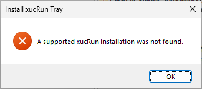
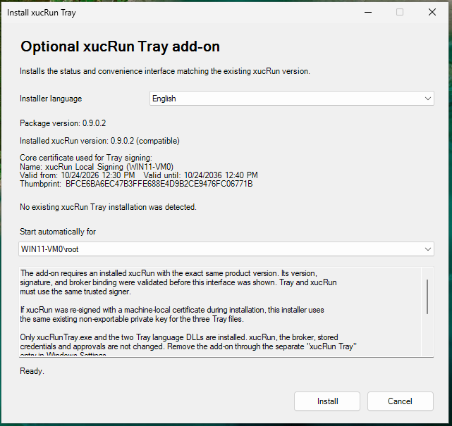
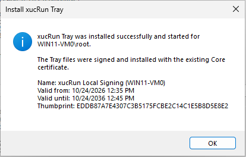
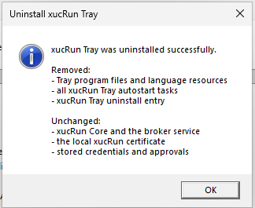
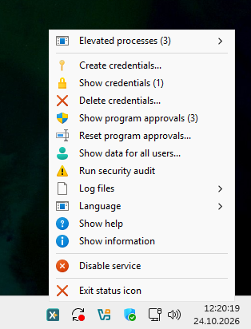
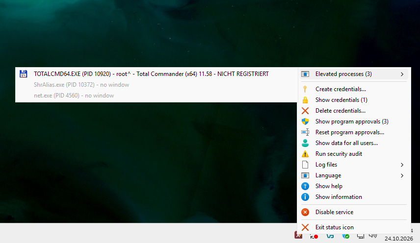

<!--
Purpose: Describes xucRun Tray, its requirements, installation, operation, and development.
Approach: Guides users from product context through safe use and removal to building from source.
-->
# xucRun Tray

**Language:** [Deutsch](README.de.md) | English

**Documentation:** [File register](FILE_REGISTER.md) | [Changelog](CHANGELOG.md) |
[Manual removal](docs/en/MANUAL_REMOVAL.md) | [xucRun](https://github.com/HT64/xucRun)

> **Status:** xucRun Tray is under development. The documentation describes the intended behavior.
> The current state may contain defects, differ from that behavior, and change. The current
> installer package and its checksums are available under
> [Releases](https://github.com/HT64/xucRun-Tray/releases).

## Motivation and purpose

xucRun Tray is an optional status and control interface for
[xucRun](https://github.com/HT64/xucRun). Its icon appears in the notification area of the Windows
taskbar next to the clock. From there, users can view relevant operating information and directly
access frequently used xucRun management functions without entering commands manually.

The Tray application does not replace xucRun and cannot be used on its own. It displays information
from xucRun and provides easier access to existing xucRun management functions. Program launches,
stored credentials, approvals, account selection, and security decisions remain xucRun
responsibilities.

## Relationship to xucRun

The broker service belongs to xucRun. It starts automatically when needed and then runs in the
background. The Tray application displays its state and provides controls through existing xucRun
functions but does not perform any broker function itself.

The Tray application:

- displays broker service and communication status;
- shows the current user context and whether the xucRun Tray process is elevated;
- lists tracked elevated processes and their windows;
- opens xucRun dialogs for managing credentials and program approvals;
- starts the xucRun security diagnostics and information views;
- provides access to configured client log files and filtered xucRun Broker events;
- switches the xucRun application language;
- starts, enables, or disables the broker service through the existing xucRun interfaces.

Sensitive operations continue to be performed by xucRun using Windows access controls and User
Account Control where required. Installing xucRun Tray does not create additional credentials,
approvals, or permissions for the broker service.

## Requirements and intended use

xucRun Tray supports Windows 10 and Windows 11 on x64 systems. It requires:

- an installed, supported xucRun;
- currently, the exact same four-part product version as xucRun;
- a signature created with the same valid local xucRun signing certificate as the installed
  xucRun;
- an existing local Windows user profile for Tray autostart.

xucRun Tray is intended for the same experienced home users and developers, self-managed computers,
and personal development or test systems as xucRun. It is not intended for unattended or
centralized privilege management, production environments, or systems requiring a
elevated level of protection.

> **Important security notice:** xucRun Tray displays status information and invokes existing xucRun
> management functions. It neither extends nor replaces xucRun's security mechanisms. The displayed
> information does not guarantee the security of the system, credentials, or launched programs.
> For requirements, safeguards, operating limits, and remaining risks, follow the security guidance
> in the
> [xucRun README](https://github.com/HT64/xucRun#requirements-and-intended-use). To the extent
> permitted by law, the warranty disclaimer and limitation of liability in the
> [Apache License 2.0](LICENSE) apply to xucRun Tray.

## Installation overview

The public Tray release package contains:

```text
xucRun-Tray-<Version>-x64.exe
SHA256SUMS.json
LICENSE
NOTICE
```

The release intentionally provides no separate binary ZIP containing `xucRunTray.exe` and its
language DLLs. The ZIP and TAR.GZ archives generated automatically by GitHub contain source code,
not an installable binary package. The published Tray installer is the supported installation
method; copying individual Tray files manually establishes neither the required common signer
identity nor the logon task.

Download all files from the same official
[xucRun Tray GitHub release](https://github.com/HT64/xucRun-Tray/releases). The provided installer
is currently not signed by a publicly trusted publisher; Windows may therefore report an unknown
publisher when it starts. Before starting it, compare its SHA-256 checksum with
`SHA256SUMS.json` and verify any available Authenticode signature.

### Graphical installation

Before opening the installation interface, the installer checks for a compatible xucRun
installation. It checks the required installed xucRun files, their signatures, installation paths,
version, and compatibility. A properly configured manual installation is therefore not rejected
solely because its Windows uninstall entry is missing. The installer stops with an error if xucRun
is missing, incompatible, or unverifiable.



After successful validation, the interface shows the installed xucRun version. For an existing
Tray installation, it also shows the registered Tray version and the time it was installed or
last updated. It also identifies the local xucRun signing certificate used to sign the xucRun Tray
files, including its name, validity period, and thumbprint. The success confirmation repeats this
certificate information.

The installer initially uses the Windows display language. Select **Installer language** to switch
the complete installation interface between German and English immediately. This selection affects
only the installer interface and does not change the machine-wide xucRun application language.



Start `xucRun-Tray-<Version>-x64.exe`. User Account Control requests administrator rights. The
installer then:

1. verifies its embedded package and product version;
2. checks the required installed xucRun files, their signatures, installation paths, version, and
   compatibility;
3. checks whether xucRun Tray and xucRun are signed with the same valid local xucRun signing
   certificate;
4. asks which existing local Windows user should start xucRun Tray automatically;
5. installs `xucRunTray.exe` and both language DLLs under `%ProgramFiles%\xucRun`;
6. creates the selected user's logon task;
7. registers a separate **xucRun Tray** entry under **Installed apps**.



xucRun uses a machine-local signing certificate. The xucRun Tray installer uses this certificate,
which was previously configured by xucRun, to sign the embedded Tray files locally. This lets
Windows and xucRun verify that xucRun and xucRun Tray belong to the same installation and have not
been replaced with differently signed files. xucRun Tray does not create a certificate or add any
trust entries. The
[Local signing certificate](https://github.com/HT64/xucRun#local-signing-certificate) section in
the xucRun README describes its purpose and storage locations.

The xucRun Tray installer does not install or modify xucRun components, stored credentials, or
approvals.

### Update and uninstall

xucRun and xucRun Tray currently require an exact four-part version match. When reinstalling the
same xucRun version, xucRun Tray can remain installed if its version and signing certificate still
match exactly. Before changing versions or uninstalling xucRun, remove **xucRun Tray** through its
separate entry under **Installed apps**. After updating xucRun, install the public xucRun Tray
release with the matching version.

To repair or reinstall the same matching version, run the xucRun Tray installer again and select
the required local user. It validates the existing installation and replaces only Tray files. It
briefly stops running Tray applications while replacing those files. After successful
installation, it restarts those applications and xucRun Tray for the newly selected signed-in
user.

Uninstalling xucRun Tray removes its files, logon tasks, and uninstall registration. xucRun,
including its broker service, local signing certificate, stored credentials, approvals, and
configuration, remains unchanged. A visible success confirmation lists removed and unchanged
components separately.



When uninstall is started through **Installed apps**, its PowerShell window remains hidden. A
failure is shown in a visible dialog instead. The technical diagnostic log is stored under
`%ProgramData%\xucRun\InstallerLogs`; the dialog shows the full path of the specific file in a
copyable field and can open the log folder directly. The log contains error, script, and system
information, but no stored passwords. The path shown in the dialog is authoritative.

## Quick start

If the selected user is currently signed in, the installer starts xucRun Tray immediately through
the non-elevated user task. Otherwise, xucRun Tray starts at that user's next Windows logon. To
start it manually, open Command Prompt and run:

```cmd
"%ProgramFiles%\xucRun\xucRunTray.exe"
```

Only one Tray instance runs for the same user session. Hover over its icon in the notification area
of the Windows taskbar next to the clock to see the user, broker service, communication, and
elevation status. Right-click the icon to open the management menu.

The icon color summarizes the current state:

- The normal icon color indicates that the broker service is running, communication is working,
  and no visible main window of an elevated process tracked by xucRun is open.
- A gray icon indicates that the broker service is stopped, disabled, or not yet available.
- A red icon indicates disrupted broker communication or at least one visible main window
  belonging to a tracked elevated process.

A red icon therefore does not always indicate an error.

If the Tray application itself is running with elevated rights, the Windows shield is also shown
on the icon. Hover over the icon to see text describing the specific state.

## Status display and menu

Depending on the current xucRun configuration and permissions, the menu provides:

- tracked elevated processes and their windows;
- creating, listing, and deleting stored credentials;
- listing and resetting program approvals;
- an administrative view across users after the required elevation;
- the xucRun security diagnostics plus help and information submenus for xucRun and xucRun Tray;
- displaying or deleting the current client log file and showing xucRun Broker events;
- deleting all client log files from the configured log directory after confirmation;
- automatic, German, and English language selection;
- enabling or disabling automatic startup for the current user account;
- starting, enabling, or disabling the broker service;
- closing the current Tray instance.



Under **Elevated processes**, the menu lists processes tracked by xucRun and their visible main
windows. Selecting a window restores it if minimized and attempts to bring it to the foreground. If
Windows prevents the foreground switch, the corresponding taskbar button flashes instead.
Processes without a suitable visible window are listed but cannot be brought forward from the
menu.



Unavailable actions are disabled. Operations that change credentials, approvals, or service state
still require the permissions and confirmations enforced by xucRun and Windows.

The language selection changes the machine-wide xucRun configuration. **Automatic** follows each
user's Windows display language, using German for a German display language and English otherwise.
After a successful change, all Tray applications registered with the broker service restart so
that icons in other user sessions use the configured language mode immediately.

## User account and autostart

The installer deliberately selects an existing local user profile and creates the non-elevated
logon task `\xucRun\BrokerStatus-<SID>` for that account. xucRun Tray then runs in that user's
interactive session, not permanently as administrator. The icon tooltip identifies the account
and indicates whether the Tray process is elevated whenever another Tray instance is present in
the same session or the Tray runs as a different account than the interactively signed-in user.
It omits this identity only when the sole instance and matching session account are both confirmed.

The default selection is the interactively signed-in user of the Windows session from which the
installer was started. This also applies when a different administrator account is used for the
UAC prompt. If that user is not selectable, the installer falls back to the elevated process
account and then to the first available entry. The selection always remains editable.

Run the installer again for each additional eligible local user and select that account each time.
Tasks already configured for other users remain in place. If the newly selected user is signed in,
xucRun Tray starts immediately for that user; otherwise, it starts at their next Windows sign-in.
Uninstalling xucRun Tray removes the tasks for all configured users together.

Depending on the current state, the menu item shows **Enable startup at Windows logon...** or
**Disable startup at Windows logon...**. Changing this setting requires UAC confirmation.
Disabling autostart leaves the current Tray instance running until it is closed manually or the
user signs out. Enabling autostart completely recreates a missing or divergent task with the
required non-elevated configuration.

The same per-user operations are available for scripts and troubleshooting through command-line
arguments:

```cmd
"%ProgramFiles%\xucRun\xucRunTray.exe" /enable-autostart
"%ProgramFiles%\xucRun\xucRunTray.exe" /disable-autostart
"%ProgramFiles%\xucRun\xucRunTray.exe" /autostart-status
"%ProgramFiles%\xucRun\xucRunTray.exe" /info
"%ProgramFiles%\xucRun\xucRunTray.exe" /help
```

`/autostart-status` displays the detected state and exits with code `0` when autostart is fully
valid and enabled, `1` when it is missing, disabled, or configured incorrectly, and `2` when its
state cannot be determined reliably. `/info` displays only Tray program and installation details.
Its shared program, signature, account, and configuration sections come from the same implementation
as `xucRun.exe /info` and show version, copyright, path, architecture, effective language and loaded
language DLL, signing certificate, account, SID, elevation, configuration file, and client logging.
The common configuration section also identifies the public Tray maintenance script. The
Tray-specific section then shows the Windows logon task without elevated privileges together with its state. Only
the path of the language DLL loaded for that output is listed; the other
installed language DLL is not. `/help` explains the public Tray commands and
their exit codes. The Help submenu opens either `xucRun.exe /help` or the Tray-specific help
directly in the running Tray instance. The information
submenu opens either `xucRun.exe /info` or the Tray-specific information view directly in the
running Tray instance. Other arguments are rejected with an error message and
`ERROR_INVALID_PARAMETER`. The internal `/broker-policy-test` integration-test argument is not
intended for normal use.

## Security considerations

Install the matching xucRun version first and then install xucRun Tray only with its installer.
The installer verifies the existing xucRun installation, product version, and signing certificate.
Do not copy the program files manually.

xucRun Tray does not:

- require an Internet connection;
- store a separate password or database of credentials;
- weaken xucRun security or signature checks;
- provide an alternative path around xucRun approvals or UAC;
- modify xucRun files during uninstallation.

A correctly signed xucRun Tray installation cannot make an already compromised computer
trustworthy. Malware with
sufficient privileges may manipulate processes, windows, configuration, or displayed information.
The same operating limits and residual risks documented for xucRun therefore also apply to
xucRun Tray.

## Language and log files

xucRun Tray uses the language configured for xucRun and can select automatic, German, or English
through its menu. A missing, invalid, or incorrectly signed language resource causes startup to fail
instead of using an unverified language file as a substitute.

Client log-file menu entries refer to the client log directory configured by xucRun. If client file
logging is disabled or no log file exists, the corresponding actions remain unavailable. **Delete
all log files...** shows the number of currently detected deletable client log files in parentheses.
The Tray rereads the logging configuration and enumerates the existing log files whenever its
context menu opens. If the configured directory, especially a network path, is unavailable,
Windows file-system timeouts can therefore also delay the opening of the Tray context menu. Changes
to the configured directory and newly created log files become available without restarting the
Tray. It also checks the configured language before opening the menu. If a valid external change
is detected, the Tray restarts itself and uses the new language; an invalid value or language
resource is reported while the Tray remains active in its current language. Regardless of the
selected UI language, technical
Broker warnings and errors are always written in English to the Windows Application event log
under the `xucRunBroker` source, as documented by xucRun. The always available **Show xucRun
Broker events** menu item opens that Windows channel without a UAC prompt and temporarily filters
the launched view to exactly that source. Other views and later Event Viewer launches remain
unfiltered. The action does not save a custom view or delete or configure events.

## Troubleshooting

- **The xucRun Tray icon does not appear:** Verify that the selected user has logged on after
  installation and that `\xucRun\BrokerStatus-<SID>` exists in Task Scheduler.
- **The installer rejects xucRun:** Verify the exact four-part versions, the supported xucRun
  installation, and the registered xucRun installation path.
- **Signing fails:** An xucRun installation signed with a machine-local certificate requires its
  existing non-exportable private key to remain available on that computer. The installer rejects
  packages whose Tray files are only partially or inconsistently signed.
- **Communication is shown as degraded:** Check the broker service state and run the xucRun security
  diagnostics from the xucRun Tray menu or with `xucRun.exe /audit`. The diagnostics check the
  installed Tray files and signatures, uninstall registration, and per-user autostart tasks.
- **Menu actions are unavailable:** The broker service may be stopped, communication may be
  unavailable, or the current account may lack the required permissions.
- **Tray cannot start after a manual file copy:** Use the installer. Version, protected path,
  signing certificate, language resources, and the logon task form part of the supported
  installation.

## Support the project

Development of xucRun Tray can be supported voluntarily on
[Patreon](https://www.patreon.com/xucRun).

## Reporting vulnerabilities

Do not disclose an unpatched or suspected vulnerability publicly. Use GitHub Private Vulnerability
Reporting for `HT64/xucRun-Tray` as described in [SECURITY.md](SECURITY.md).

## Build and package

Use the xucRun and xucRun Tray repositories as sibling checkouts:

```text
repos\
├── xucRun-Core\
└── xucRun-Tray\
```

A direct build uses the sibling repository checkout `..\xucRun-Core` by default.
`XucRunCoreRoot` can select another controlled xucRun checkout. `Dependencies.json` identifies the
xucRun revision required for the build; the selected checkout must match it.

Build and test an unsigned Debug package:

```powershell
& MSBuild.exe .\XUCRun-Tray.sln `
  /t:Build /p:Configuration=Debug /p:Platform=x64 /m

.\New-xucRunTray-Package.ps1 -Configuration Debug
.\Test-TrayAddonPackage.ps1 -Configuration Debug
```

A Release package is created in the same way with `Release`:

```powershell
& MSBuild.exe .\XUCRun-Tray.sln `
  /t:Build /p:Configuration=Release /p:Platform=x64 /m

.\New-xucRunTray-Package.ps1 -Configuration Release
.\Test-TrayAddonPackage.ps1 -Configuration Release
```

Build outputs are written below `artifacts\<Configuration>` and complete packages below
`artifacts\Package\<Configuration>`.

## Contributing

External pull requests are not accepted at this time. See [CONTRIBUTING.md](CONTRIBUTING.md).

## License

xucRun Tray is licensed under the Apache License 2.0. `LICENSE` and `NOTICE` are authoritative.
