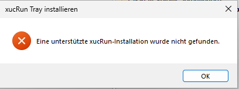
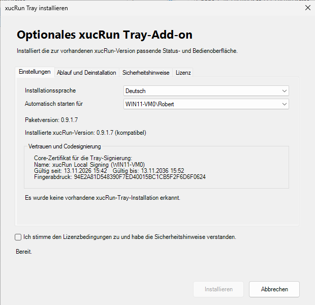
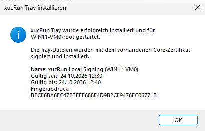
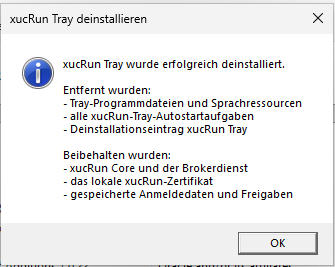

<!--
Purpose: Beschreibt Installation, Aktualisierung und Deinstallation von xucRun Tray.
Approach: Führt vom geprüften Releasepaket über die grafische Installation bis zu Wartung und Entfernung.
-->
# xucRun Tray installieren und aktualisieren

**Sprache:** Deutsch | [English](../en/INSTALLATION.md)

## Voraussetzungen

- ein x64-Windows-System,
- Administratorrechte,
- eine unterstützte xucRun-Installation mit exakt derselben vierteiligen Produktversion,
- das von dieser xucRun-Installation eingerichtete gültige lokale Signaturzertifikat.

Der Tray-Installer prüft Version, Installationspfade und Signaturen und signiert die
Tray-Komponenten lokal mit dem bereits von xucRun eingerichteten Zertifikat.

## Releasepaket

xucRun Tray ist ein Open-Source-Projekt unter der [Apache License 2.0](../../LICENSE).
Das öffentliche Tray-Releasepaket enthält:

```text
xucRun-Tray-<Version>-x64.exe
BUILD-TOOLCHAIN.txt
SHA256SUMS.txt
LICENSE
NOTICE
```

`BUILD-TOOLCHAIN.txt` nennt den Quellcommit und die beim Build tatsächlich aufgelösten Versionen
von Visual Studio, MSBuild, MSVC und Windows SDK. Seine SHA-256-Prüfsumme steht ebenfalls in
`SHA256SUMS.txt`.

Das Release enthält kein separates Binär-ZIP mit `xucRunTray.exe` und den Sprach-DLLs. Die von
GitHub automatisch angebotenen ZIP- und TAR.GZ-Archive enthalten den Quelltext, nicht ein
installierbares Binärpaket. Der Tray-Installer ist der unterstützte Installationsweg; ein manuelles
Kopieren einzelner Dateien stellt weder die erforderliche gemeinsame Signiereridentität her noch
richtet es die Anmeldeaufgabe ein.

Laden Sie alle Dateien aus demselben
[xucRun-Tray-GitHub-Release](https://github.com/HT64/xucRun-Tray/releases/latest) herunter. Der
Installer ist nicht Authenticode-signiert; Windows kann deshalb beim Start einen unbekannten
Herausgeber melden.

Die lokale SHA-256-Prüfsumme des Installers kann beispielsweise so angezeigt werden:

```powershell
Get-FileHash .\xucRun-Tray-*-x64.exe -Algorithm SHA256
```

Der ausgegebene Hash muss vollständig mit dem Eintrag für diese Datei in `SHA256SUMS.txt`
übereinstimmen. Bei einer Abweichung die Datei nicht ausführen.

## Grafische Installation

Vor dem Öffnen der Installationsoberfläche prüft der Installer, ob eine passende xucRun-Installation
vorhanden ist. Er prüft die erforderlichen xucRun-Dateien, deren Signaturen, Installationspfade,
Version und Kompatibilität. Eine ordnungsgemäße manuelle Core-Installation wird nicht allein wegen
eines fehlenden Windows-Deinstallationseintrags abgelehnt. Bei fehlender, abweichender oder nicht
überprüfbarer xucRun-Installation bricht der Installer mit einer Fehlermeldung ab.



Starten Sie `xucRun-Tray-<Version>-x64.exe` und bestätigen Sie die Windows-UAC-Anforderung. Der
Installer:

1. prüft eingebettetes Paket und Produktversion;
2. prüft die installierte xucRun-Version, Dateien, Signaturen und Pfade;
3. prüft die gemeinsame Signiereridentität von xucRun und xucRun Tray;
4. fragt, für welchen vorhandenen lokalen Windows-Benutzer das Tray automatisch starten soll;
5. verlangt die Zustimmung zu Lizenzbedingungen und Sicherheitshinweisen;
6. installiert Tray-Programm, Installationsskript, Sprach-DLLs sowie Lizenz- und Urheberhinweise;
7. erstellt die nicht erhöhte Anmeldeaufgabe des gewählten Benutzers;
8. registriert unter **Installierte Apps** den eigenen Eintrag **xucRun Tray**.



Die Installationssprache lässt sich unmittelbar zwischen Deutsch und Englisch umschalten. Diese
Auswahl betrifft nur die Installer-Oberfläche und ändert nicht die computerweite
xucRun-Programmsprache.

Nach erfolgreicher Installation zeigt der Installer die verwendete xucRun-Version und das lokale
Signaturzertifikat mit Name, Gültigkeitszeitraum und Fingerabdruck an. Ist der gewählte Benutzer
angemeldet, startet das Tray sofort über seine nicht erhöhte Anmeldeaufgabe; andernfalls bei dessen
nächster Windows-Anmeldung.



Der Installer legt `LICENSE-xucRun-Tray.txt` und `NOTICE-xucRun-Tray.txt` unter
`%ProgramFiles%\xucRun\Licenses` ab. Diese Textdateien sind nicht Authenticode-signiert und werden
mit dem Tray entfernt.

## Lokale Signierung

xucRun verwendet ein rechnerlokales Signaturzertifikat. Der Tray-Installer nutzt dieses bereits vom
Core eingerichtete Zertifikat, um die eingebetteten Tray-Dateien lokal zu signieren. Dadurch können
Windows und xucRun prüfen, dass Core und Tray zur selben Installation gehören und nicht durch
abweichend signierte Dateien ersetzt wurden. xucRun Tray erzeugt kein eigenes Zertifikat und fügt
keine weiteren Vertrauenseinträge hinzu.

Zweck und Speicherorte des Zertifikats beschreibt die
[xucRun-Installationsanleitung](https://github.com/HT64/xucRun/blob/main/docs/de/INSTALLATION.md#lokale-signierung-und-vertrauen).

Der Tray-Installer installiert oder verändert keine Core-Komponenten und keine gespeicherten
Anmeldedaten oder Freigaben.

## Installation prüfen

Nach der Installation können die Tray-Laufzeitinformationen und die sicherheitsrelevanten
Eigenschaften der gemeinsamen Installation geprüft werden:

```powershell
& 'C:\Program Files\xucRun\xucRunTray.exe' /info
& 'C:\Program Files\xucRun\xucRun.exe' /audit
```

`xucRunTray.exe /info` zeigt unter anderem Version, Signierer, Sprache und Zustand der
Anmeldeaufgabe. `xucRun.exe /audit` prüft auch die installierten Tray-Dateien und Signaturen, die
Deinstallationsregistrierung und die benutzerbezogenen Autostartaufgaben.

## Aktualisieren und reparieren

xucRun und xucRun Tray benötigen exakt dieselbe vierteilige Produktversion. Bei einer erneuten
Installation derselben xucRun-Version kann das Tray installiert bleiben, wenn Version und
Signaturzertifikat weiterhin passen. Vor einem Versionswechsel muss xucRun Tray entfernt werden.
Nach dem Core-Update wird die Tray-Version mit derselben Versionsnummer installiert.

Zur Reparatur oder erneuten Installation derselben Version starte den Tray-Installer erneut und
wähle den gewünschten lokalen Benutzer. Er prüft die vorhandene Installation, beendet laufende
Tray-Instanzen kurzzeitig und ersetzt ausschließlich Tray-Dateien. Nach erfolgreicher Installation
startet er die zuvor laufenden Instanzen und das Tray des neu ausgewählten angemeldeten Benutzers
wieder.

## Deinstallieren

Entfernen Sie **xucRun Tray** über seinen eigenen Eintrag unter **Installierte Apps**, bevor xucRun
deinstalliert oder auf eine andere Version aktualisiert wird.

Alternativ kann die Deinstallation direkt über das installierte Skript gestartet werden:

```powershell
powershell.exe -NoProfile -ExecutionPolicy Bypass `
  -File 'C:\Program Files\xucRun\Install-xucRunTray.ps1' `
  -Uninstall
```

Die Tray-Deinstallation entfernt Tray-Dateien, Anmeldeaufgaben und den Tray-Deinstallationseintrag.
xucRun einschließlich Brokerdienst, lokalem Signaturzertifikat, gespeicherten Anmeldedaten,
Freigaben und Konfiguration bleibt unverändert.



Beim Start über **Installierte Apps** bleibt das PowerShell-Fenster verborgen. Ein Fehler erscheint
in einem sichtbaren Dialog. Das technische Diagnoseprotokoll wird nach Möglichkeit unter
`%ProgramData%\xucRun\InstallerLogs` gespeichert; der Dialog zeigt den vollständigen Dateipfad und
kann den Protokollordner öffnen. Das Protokoll enthält Fehler-, Skript- und Systeminformationen,
aber keine gespeicherten Kennwörter.

Verwenden Sie die Anleitung zur [manuellen Entfernung](MANUAL_REMOVAL.md) nur, wenn die normale
Deinstallation nicht verfügbar ist oder nicht abgeschlossen werden kann.
