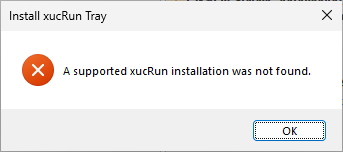
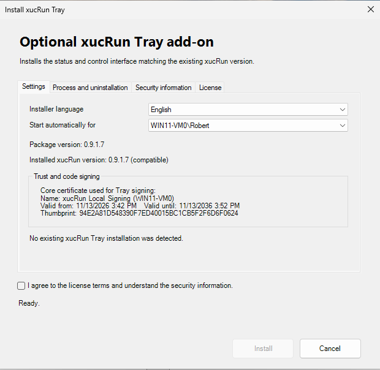
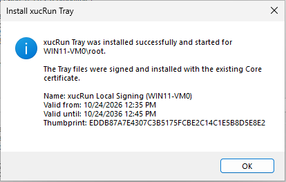
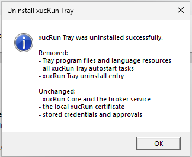

<!--
Purpose: Describes installation, update, and uninstallation of xucRun Tray.
Approach: Guides users from a verified release package through graphical installation and maintenance.
-->
# Install and update xucRun Tray

**Language:** [Deutsch](../de/INSTALLATION.md) | English

## Prerequisites

- an x64 Windows system,
- administrator rights,
- a supported xucRun installation with the exact same four-part product version,
- the valid local signing certificate configured by that xucRun installation.

The Tray installer verifies the version, installation paths, and signatures and locally signs the
Tray components with the certificate already configured by xucRun.

## Release package

xucRun Tray is an open-source project under the [Apache License 2.0](../../LICENSE).
The public Tray release package contains:

```text
xucRun-Tray-<Version>-x64.exe
BUILD-TOOLCHAIN.txt
SHA256SUMS.txt
LICENSE
NOTICE
```

`BUILD-TOOLCHAIN.txt` identifies the source commit and the Visual Studio, MSBuild, MSVC, and
Windows SDK versions actually resolved for the build. Its SHA-256 checksum is also included in
`SHA256SUMS.txt`.

The release provides no separate binary ZIP containing `xucRunTray.exe` and its language DLLs.
The ZIP and TAR.GZ archives generated automatically by GitHub contain source code, not an
installable binary package. The Tray installer is the supported installation method; copying
individual files manually establishes neither the required common signer identity nor the logon
task.

Download all files from the same
[xucRun Tray GitHub release](https://github.com/HT64/xucRun-Tray/releases/latest). The installer is
not Authenticode-signed, so Windows may report an unknown publisher when it starts.

Display the installer's local SHA-256 checksum, for example, with:

```powershell
Get-FileHash .\xucRun-Tray-*-x64.exe -Algorithm SHA256
```

The complete hash must match the entry for that file in `SHA256SUMS.txt`. If the hashes differ, do
not run the installer.

## Graphical installation

Before opening the installation interface, the installer checks for a compatible xucRun
installation. It verifies the required xucRun files, signatures, installation paths, version, and
compatibility. A properly configured manual Core installation is not rejected solely because its
Windows uninstall entry is missing. The installer stops with an error if xucRun is missing,
incompatible, or unverifiable.



Run `xucRun-Tray-<Version>-x64.exe` and approve the Windows UAC request. The installer:

1. verifies its embedded package and product version;
2. checks the installed xucRun version, files, signatures, and paths;
3. verifies that xucRun and xucRun Tray use the same signer identity;
4. asks which existing local Windows user should start the Tray automatically;
5. requires agreement to the license terms and acknowledgment of the security information;
6. installs the Tray program, installer script, language DLLs, license, and attribution notices;
7. creates the selected user's non-elevated logon task;
8. registers a separate **xucRun Tray** entry under **Installed apps**.



The installer language can be switched immediately between German and English. This selection
affects only the installer interface and does not change the machine-wide xucRun application
language.

After successful installation, the installer shows the xucRun version and the local signing
certificate, including its name, validity period, and thumbprint. If the selected user is signed
in, the Tray starts immediately through its non-elevated logon task; otherwise, it starts at that
user's next Windows logon.



The installer places `LICENSE-xucRun-Tray.txt` and `NOTICE-xucRun-Tray.txt` in
`%ProgramFiles%\xucRun\Licenses`. These text files are not Authenticode-signed and are removed with
the Tray.

## Local signing

xucRun uses a machine-local signing certificate. The Tray installer uses the certificate already
configured by the Core to sign the embedded Tray files locally. This lets Windows and xucRun
verify that Core and Tray belong to the same installation and have not been replaced with
differently signed files. xucRun Tray does not create a certificate or add trust entries.

The
[xucRun installation guide](https://github.com/HT64/xucRun/blob/main/docs/en/INSTALLATION.md#local-signing-and-trust)
describes the certificate's purpose and storage locations.

The Tray installer does not install or modify Core components, stored credentials, or approvals.

## Verify the installation

After installation, verify the Tray runtime information and security-relevant properties of the
combined installation:

```powershell
& 'C:\Program Files\xucRun\xucRunTray.exe' /info
& 'C:\Program Files\xucRun\xucRun.exe' /audit
```

`xucRunTray.exe /info` shows, among other details, the version, signer, language, and logon-task
state. `xucRun.exe /audit` also checks the installed Tray files and signatures, uninstall
registration, and per-user autostart tasks.

## Update and repair

xucRun and xucRun Tray require an exact four-part product-version match. When reinstalling the same
xucRun version, the Tray can remain installed if its version and signing certificate still match.
Remove xucRun Tray before changing versions. After updating the Core, install the Tray version with
the same version number.

To repair or reinstall the same version, run the Tray installer again and select the required local
user. It validates the existing installation, briefly stops running Tray instances, and replaces
only Tray files. After successful installation, it restarts the previously running instances and
the newly selected signed-in user's Tray.

## Uninstall

Remove **xucRun Tray** through its separate entry under **Installed apps** before uninstalling
xucRun or updating it to another version.

Alternatively, start uninstallation directly through the installed script:

```powershell
powershell.exe -NoProfile -ExecutionPolicy Bypass `
  -File 'C:\Program Files\xucRun\Install-xucRunTray.ps1' `
  -Uninstall
```

Tray uninstallation removes Tray files, logon tasks, and the Tray uninstall entry. xucRun,
including its broker service, local signing certificate, stored credentials, approvals, and
configuration, remains unchanged.



When uninstall is started through **Installed apps**, its PowerShell window remains hidden. A
failure appears in a visible dialog. When possible, the technical diagnostic log is stored under
`%ProgramData%\xucRun\InstallerLogs`; the dialog shows its full path and can open the log folder.
The log contains error, script, and system information but no stored passwords.

Use the [manual removal instructions](MANUAL_REMOVAL.md) only if normal uninstallation is
unavailable or cannot complete.
